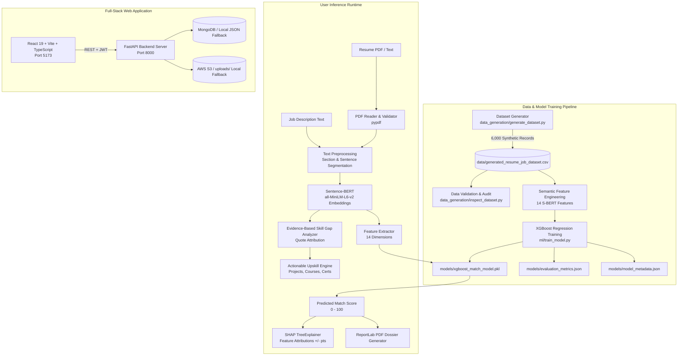

# CareerMatch AI 🎯
> *"Know Your Job Fit. Before You Apply."*

**Explainable AI-Based Resume Screening and Skill Gap Analysis System**  
*Capstone Project — B.Tech Artificial Intelligence & Data Science*

---

## 1. Executive Summary & Problem Definition

Traditional Applicant Tracking Systems (ATS) and resume screeners suffer from a fatal structural flaw: they rely on **crude keyword matching, token intersection, or lexical TF-IDF counting**. This legacy approach leads to severe failure modes:

1. **Vocabulary Mismatch:** A candidate with extensive experience in *"building predictive models using Scikit-Learn and Python"* is rejected by an ATS searching for *"machine learning modeling"*, despite being conceptually identical.
2. **Rewarding Deceptive Keyword Stuffing:** Unqualified applicants can manipulate legacy ATS software by pasting invisible white-text keywords into their resume margins.
3. **Black-Box Opacity:** When candidates are rejected or given low match scores, they are given zero explanation or feedback regarding *why* they were rated poorly.
4. **Simplistic Skill Subtraction:** Existing tools calculate skill gaps as a naive set difference:
   $$\text{Gap} = \text{Job Skills} \setminus \text{Resume Skills}$$
   ignoring transferable capabilities, partial proficiencies, and contextual hands-on project execution.

### The CareerMatch AI Solution
**CareerMatch AI** solves these challenges by combining:
- **Dense Vector Semantic Representations:** Pretrained **Sentence-BERT (`sentence-transformers/all-MiniLM-L6-v2`)** maps both resume content and job descriptions into a shared 384-dimensional metric space where semantic cosine similarity captures genuine technical equivalence.
- **14-Feature Multi-Dimensional Alignment Pipeline:** Evaluates overall text similarity, section-by-section fit, technical capability coverage, non-linear experience duration ratios, degree tier compatibility, and project relevance.
- **Gradient Boosted Decision Trees (XGBoost Regressor):** Combines the 14 semantic dimensions into an optimized, robust `match_score` (0–100) with L1/L2 shrinkage regularization to prevent overfitting.
- **Game-Theoretic Explainability (SHAP):** Uses `shap.TreeExplainer` to calculate exact local Shapley additive attributions for every prediction, showing candidates exactly how many points each dimension added or subtracted.
- **Evidence-Based Skill Gap Analysis:** Cites literal quote sentences from the candidate's resume as verified proof, classifying requirements into **Strongly Demonstrated** ($\ge 0.68$), **Partially Demonstrated** ($0.48 - 0.68$), and **Not Clearly Demonstrated** ($< 0.48$).
- **Personalized Upskill Engine:** Translates identified gaps into concrete portfolio projects, specific top-rated bridge courses (Coursera/edX), and resume bullet phrasing recommendations.
- **Full-Stack Production SaaS:** React 19 + TypeScript + Vite + Tailwind CSS frontend with a FastAPI backend, dual-mode MongoDB / Local JSON fallback, and AWS S3 / local disk storage fallback.

---

## 2. End-to-End System Architecture



---

## 3. Data Generation Pipeline (`data_generation/`)

### Why Synthetic Data?
1. **Privacy & Regulatory Compliance:** Real candidate resumes contain Personally Identifiable Information (PII) protected under GDPR, CCPA, and privacy laws.
2. **Historical Hiring Bias:** Historical corporate ATS datasets perpetuate gender, racial, and collegiate pedigree biases.
3. **Controlled Multi-Dimensional Ground Truth:** Synthetic modeling allows controlled, transparent target score generation across all 13 roles and 7 experience brackets without label noise or target leakage.

### Generation Methodology
- **Record Count:** 6,000 realistic resume-job description pairs.
- **Random Seed:** `DATASET_SEED = 42` (100% reproducible).
- **Roles Represented (13):** Machine Learning Engineer, Data Scientist, Data Analyst, AI Engineer, NLP Engineer, Computer Vision Engineer, Software Engineer, Backend Developer, Frontend Developer, Data Engineer, Cloud Engineer, DevOps Engineer, Business Analyst.
- **Experience Brackets (7):** Fresher (0 yrs), Intern (0.2–0.8 yrs), 0–1 yrs, 1–2 yrs, 2–3 yrs, 3–5 yrs, 5+ yrs.
- **Controlled Target Calculation Formula:**
  $$\text{Raw Score} = 0.25 \cdot C_{\text{align}} + 0.20 \cdot R_{\text{align}} + 0.18 \cdot E_{\text{align}} + 0.15 \cdot P_{\text{align}} + 0.12 \cdot D_{\text{align}} + 0.10 \cdot Q_{\text{align}}$$
  $$\text{match\_score} = \text{clip}(\text{Raw Score} \times 100 + \mathcal{N}(0, 2.5), 5.0, 99.0)$$
- **Zero Keyword Matching Guarantee:** The target score is derived purely from multi-dimensional latent alignments; no keyword counts or word overlap calculations are present.
- **Distribution Balance:**
  - Low Match ($< 50$): $\approx 15.2\%$
  - Medium Match ($50 - 75$): $\approx 37.7\%$
  - High Match ($\ge 75$): $\approx 47.0\%$

---

## 4. The 14 Semantic Engineered Features

| # | Feature Name | Computation Methodology | Range |
|---|---|---|---|
| 1 | `resume_job_semantic_similarity` | Cosine similarity of global Sentence-BERT embeddings of resume & JD | $[0, 1]$ |
| 2 | `section_semantic_similarity` | Average cosine similarity across matched sections (Summary, Skills) | $[0, 1]$ |
| 3 | `technical_requirement_alignment`| Mean similarity of candidate evidence sentences to job criteria | $[0, 1]$ |
| 4 | `experience_alignment` | Non-linear ratio comparing candidate tenure to job minimum tenure | $[0, 1]$ |
| 5 | `education_alignment` | Degree tier compatibility score (Doctorate, Tech PG/UG, Non-Tech) | $[0, 1]$ |
| 6 | `project_alignment` | Semantic similarity of candidate project descriptions to job duties | $[0, 1]$ |
| 7 | `responsibility_alignment` | Overlap of past professional responsibilities with target role | $[0, 1]$ |
| 8 | `role_alignment` | Dense semantic similarity of candidate title to target position title | $[0, 1]$ |
| 9 | `seniority_alignment` | Match between candidate seniority indicators and job seniority expectations | $[0, 1]$ |
| 10 | `semantic_skill_coverage` | Proportion of job criteria meeting evidence demonstration threshold | $[0, 1]$ |
| 11 | `missing_requirement_semantic_gap` | Average semantic distance of candidate's 3 weakest requirements | $[0, 1]$ |
| 12 | `resume_completeness` | Structural presence index (Summary, Experience, Education, Projects, Skills) | $[0, 1]$ |
| 13 | `project_depth` | Density and specificity of technical project descriptions | $[0, 1]$ |
| 14 | `internship_alignment` | Practical industry internship representation factor | $[0, 1]$ |

---

## 5. Machine Learning & SHAP Explainability

### Model Architecture
- **Algorithm:** `xgb.XGBRegressor`
- **Objective Function:** `reg:squarederror`
- **Hyperparameters:** `n_estimators=250`, `max_depth=5`, `learning_rate=0.08`, `subsample=0.85`, `colsample_bytree=0.85`, `reg_alpha=0.1`, `reg_lambda=1.0`.
- **Validation:** 80/20 train/test split + 5-fold cross-validation.

### Why SHAP?
Complex non-linear models like gradient boosted trees are typically treated as black boxes. CareerMatch AI uses **SHAP (SHapley Additive exPlanations)** based on cooperative game theory:
$$f(x) = \phi_0 + \sum_{i=1}^{M} \phi_i(x)$$
Where:
- $\phi_0 = \mathbb{E}[f(X)]$ is the base expected score across the dataset.
- $\phi_i(x)$ is the Shapley value (marginal contribution in points) of feature $i$ for instance $x$.
- Satisfies **Local Accuracy, Missingness, and Consistency** axioms.

---

## 6. Technology Stack

- **Frontend:** React 19, TypeScript, Vite, Tailwind CSS, Lucide React, Recharts.
- **Backend:** FastAPI (Python 3.11 / 3.13), Uvicorn, Pydantic v2.
- **NLP & ML:** `sentence-transformers` (`all-MiniLM-L6-v2`), `xgboost`, `shap`, `scikit-learn`, `pypdf`.
- **Document Generation:** ReportLab (branded PDF dossiers).
- **Database:** MongoDB (Motor async driver) with automatic local JSON fallback (`data/local_db.json`).
- **Storage:** AWS S3 with automatic local disk fallback (`uploads/`).
- **Security:** JWT authentication, bcrypt password hashing, path traversal sanitization, PDF signature checks.

---

## 7. Local Setup & Execution Guide

### Step 1: Clone Repository & Create Virtual Environment
```bash
# Windows
python -m venv venv
venv\Scripts\activate

# Linux / macOS
python3 -m venv venv
source venv/bin/activate
```

### Step 2: Install Python Dependencies
```bash
pip install --upgrade pip
pip install -r requirements.txt
```

### Step 3: Generate the Dataset
Generates 6,000 realistic records with controlled semantic scoring:
```bash
python -m data_generation.generate_dataset
```

### Step 4: Inspect Dataset Statistics
Produces console metrics and generates `reports/dataset_analysis.html`:
```bash
python -m data_generation.inspect_dataset
```

### Step 5: Train the XGBoost Model
Trains the model, evaluates test metrics, benchmarks against baseline, and saves artifacts:
```bash
python -m ml.train_model
```

### Step 6: Start FastAPI Backend Server
```bash
uvicorn backend.main:app --host 0.0.0.0 --port 8000 --reload
```
API Documentation will be live at: `http://localhost:8000/docs`

### Step 7: Start React Frontend
In a new terminal:
```bash
cd frontend
npm install
npm run dev
```
Open your browser at: `http://localhost:5173`

---

## 8. Running Automated Tests

Run the comprehensive test suite covering dataset validation, extractors, storage fallback, PDF generation, and API routes:
```bash
pytest tests/ -v
```

---

## 9. API Endpoint Reference

| Method | Endpoint | Description | Protected |
|---|---|---|---|
| `POST` | `/api/auth/register` | Register new candidate account | No |
| `POST` | `/api/auth/login` | Authenticate and issue JWT | No |
| `GET` | `/api/auth/me` | Fetch authenticated user profile | Yes |
| `POST` | `/api/resumes` | Upload and parse PDF resume | Yes |
| `GET` | `/api/resumes` | List candidate resume versions | Yes |
| `DELETE` | `/api/resumes/{id}` | Delete resume record and file | Yes |
| `POST` | `/api/jobs` | Save target job posting | Yes |
| `GET` | `/api/jobs` | List saved target jobs | Yes |
| `PUT` | `/api/jobs/{id}` | Update job posting status | Yes |
| `POST` | `/api/analyses` | Run full S-BERT + XGBoost + SHAP pipeline | Yes |
| `GET` | `/api/analyses` | List historical evaluations | Yes |
| `GET` | `/api/analyses/{id}` | Get detailed evaluation dossier | Yes |
| `GET` | `/api/reports/{id}` | Download official branded PDF report | Yes |
| `GET` | `/api/recommendations/catalog` | Fetch curated learning blueprints | Yes |
| `GET` | `/api/health` | System telemetry and diagnostics | No |

---

## 10. B.Tech Viva Preparation Guide

### Top Viva Questions & Answers

#### Q1: Why did your project abandon keyword matching?
**Answer:** Keyword matching counts token occurrences. It produces high false negatives for qualified candidates using paraphrased vocabulary (e.g. *"FastAPI REST services"* vs *"Backend web development"*) and encourages keyword stuffing. Sentence-BERT maps phrases into dense vector space where cosine similarity measures genuine contextual semantic intent.

#### Q2: What is the purpose of XGBoost if you already have embeddings?
**Answer:** S-BERT embeddings measure textual semantic similarity, but hiring decisions involve heterogeneous multi-dimensional criteria—such as tenure duration gaps, degree tiers, and project depth. XGBoost combines 14 diverse semantic features into a single optimized regressor that significantly outperforms single-dimension cosine similarity ($R^2$ gain $> +0.35$).

#### Q3: How do you mathematically guarantee that SHAP values are trustworthy?
**Answer:** SHAP values are derived from cooperative game theory (Lloyd Shapley, 1953). They are the unique additive attribution method satisfying four foundational axioms:
1. **Efficiency:** $\sum_{i=1}^M \phi_i(x) = f(x) - \mathbb{E}[f(X)]$
2. **Symmetry:** Identical contributors receive identical values.
3. **Dummy/Null Player:** Features with zero marginal impact receive zero attribution.
4. **Additivity:** Attributions across ensemble trees sum linearly.

#### Q4: How did you prevent target data leakage?
**Answer:** The target `match_score` is never included in the feature set. All 14 input features are computed independently from the raw text representations of the resume and job description using S-BERT vector calculations and NLP parsing before inference.

---

## 11. Ethical AI & Responsible Disclosure
> **Statutory Disclaimer:** CareerMatch AI provides informational resume-to-job alignment insights. It does not make automated employment decisions and should not be interpreted as a probability of employment. All personal identifiers (names, gender, contact information) are excluded from the feature space to prevent demographic bias.
